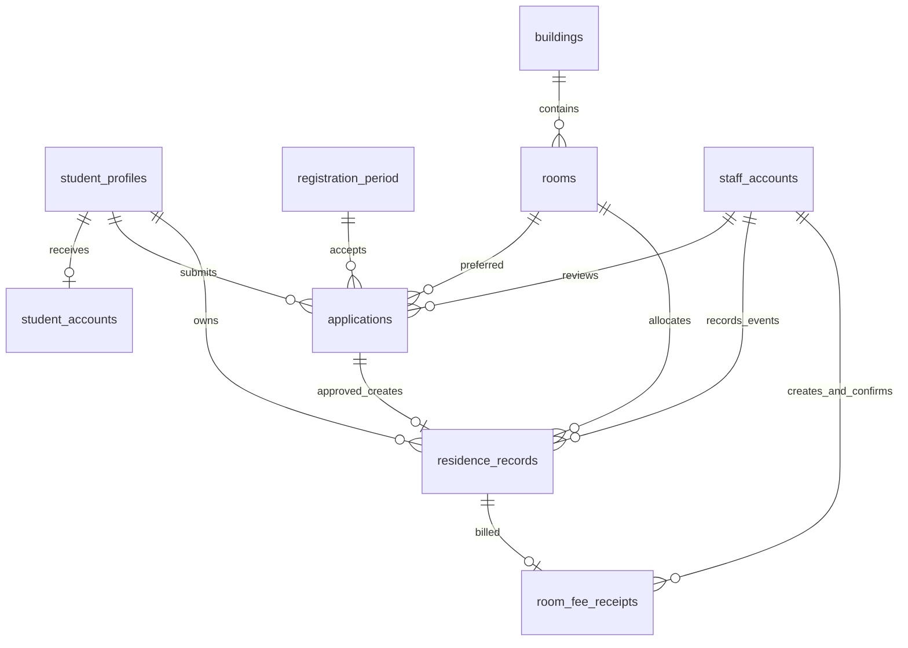

# Quan hệ và vòng đời dữ liệu

Revision 1.0.0. Khóa ngoại đều `ON DELETE RESTRICT`; không cascade xóa dữ liệu nghiệp vụ.

## Cardinality và identity

- Profile có thể chưa có account; `student_accounts.student_id UNIQUE NOT NULL` bảo đảm tối đa một account. MSSV lấy từ profile khi login `accountType=STUDENT`.
- `staff_accounts` chỉ `BQL/ADMIN`; `student_accounts` chỉ `SV`. Hai UUID có thể trùng giữa hai bảng nên session phải giữ `actorKind + accountId + sessionVersion`; không tìm account theo UUID mà bỏ nguồn.
- Một kỳ có `id=1`, chỉ cập nhật `OPEN/CLOSED`; đóng vẫn duyệt đơn đã gửi. Không thêm endpoint tạo/xóa kỳ.
- Mỗi sinh viên có nhiều đơn lịch sử nhưng một `PENDING`; một hồ sơ mở `ALLOCATED/CHECKED_IN`. Không tự hủy đơn.
- Đơn `APPROVED` phải có đúng một residence ở thời điểm COMMIT. Deferred constraint trigger kiểm tra cặp này. API duyệt cập nhật đơn trước rồi tạo residence trong cùng transaction.
- Residence trỏ phòng được xếp thực tế, có thể khác `preferred_room_id`; không sửa liên kết để chuyển phòng.
- Một residence có tối đa một receipt. Không xóa receipt khi residence `CANCELLED/ENDED`; có thể xác nhận tiền về sau.

## Chính sách lịch sử

ID, business code và các liên kết nguồn bất biến. Thay tên tòa/họ tên hiển thị cập nhật danh mục hiện hành; prototype không snapshot tên cũ vì không có yêu cầu đó. Giá phiếu là ngoại lệ phải snapshot: `amount_vnd` lấy giá lúc lập và bất biến sau đó.

`applications`, `residence_records`, `room_fee_receipts`, `registration_period` có trigger từ chối DELETE. Bảng còn lại không có API DELETE; FK giữ quan hệ được tham chiếu. Quyền SQL trực tiếp là quyền vận hành đặc biệt, không thay RBAC tại API.
